# InquiTrack — Customer Inquiry Management System

InquiTrack is a small full-stack workspace for staff to sign in, record customer inquiries, find them later, and move them through a clear status lifecycle. It was built for the supplied Fullstack Development Technical Assessment, which evaluates the complete workflow across the frontend, API, and PostgreSQL database.

## Assessment workflow

- **Sign in:** seeded staff account; the API validates credentials and protects inquiry endpoints with an HTTP-only session cookie.
- **Capture:** authenticated staff can record a customer name, contact method, subject, and description. The API validates submissions independently of the form.
- **Find and review:** search by inquiry ID, customer, or status; filter by status; see inquiry and update dates; open an inquiry to review its details and status history.
- **Manage lifecycle:** move inquiries through `New`, `In Progress`, and `Resolved`, including reopening a resolved inquiry. The API rejects invalid transitions.
- **Persistence:** PostgreSQL is accessed through the Express API; the Next.js frontend does not use a mock-only backend.
- **Trust and feedback:** unauthenticated requests are rejected by the API; invalid IDs and missing records return distinct errors. The UI includes loading, empty, validation, API failure, and stale-update feedback. Updates carry the version last seen and return `409 Conflict` instead of silently overwriting a newer version.

## Stack and structure

- Frontend: Next.js and React in `apps/web`
- Backend: Node.js and Express in `apps/api`
- Database: PostgreSQL 16, started with Docker Compose
- Architecture: client–server, with a separate frontend and backend workspace in one repository. The API owns authentication, validation, workflow rules, and database access. This keeps the assessment-sized workflow understandable without the operational overhead of microservices.

## Prerequisites

- Node.js 20 or newer and npm
- Docker Desktop (or another Docker Compose implementation)

## Run locally

Run these commands from the repository root in PowerShell, Command Prompt, or a terminal:

```sh
copy .env.example .env
docker compose up -d db
npm install
npm run db:migrate
npm run db:seed
npm run db:seed:inquiries
npm run dev
```

Open <http://localhost:3000>. The API health check is <http://localhost:4000/health>. The database is exposed on port `5433` so it does not conflict with a local PostgreSQL server on the default port.

The local demo login is **staff@example.com** / **staff123**. These credentials are deliberately simple for the assessment demonstration; use them only in a local development database. The seeder accepts passwords of at least 8 characters. For a non-demo environment, set a private password in `.env` before running `npm run db:seed`. The actual `.env` file is ignored by Git.

The seeded inquiry script creates or refreshes four examples with different inquiry/update dates and status history for in-progress and resolved examples. It is safe to rerun against the local assessment database.

## Tests and build

Run both test suites from the repository root:

```sh
npm test
```

The backend suite (`apps/api/test/inquiry-rules.test.js`) contains these tests:

- `inquiry validation rejects missing fields and trims accepted values` — required fields are rejected and accepted values are trimmed.
- `status transitions permit the lifecycle and reopening, but reject skipped steps` — valid lifecycle changes and reopening are allowed; skipped transitions are rejected.
- `inquiry IDs must be valid UUIDs before they reach PostgreSQL` — malformed IDs are identified before database access.

The frontend suite (`apps/web/test/new-inquiry-form.test.jsx`) contains this test:

- `shows a server validation error and leaves the form available to correct` — the form displays an API validation error and preserves entered values so the user can correct them.

Run either suite separately:

```sh
npm run test --workspace=@inquiry/api
npm run test --workspace=@inquiry/web
```

Build the frontend for production:

```sh
npm run build
```

The current tests are focused unit/component tests. Gaps include authenticated HTTP/database integration tests, session expiry tests, and full browser automation; those should be added next.

## Application screenshots

Screenshots are stored in `docs/screenshots/` and embedded below. Select an image to open it at full size.

### Dashboard overview

[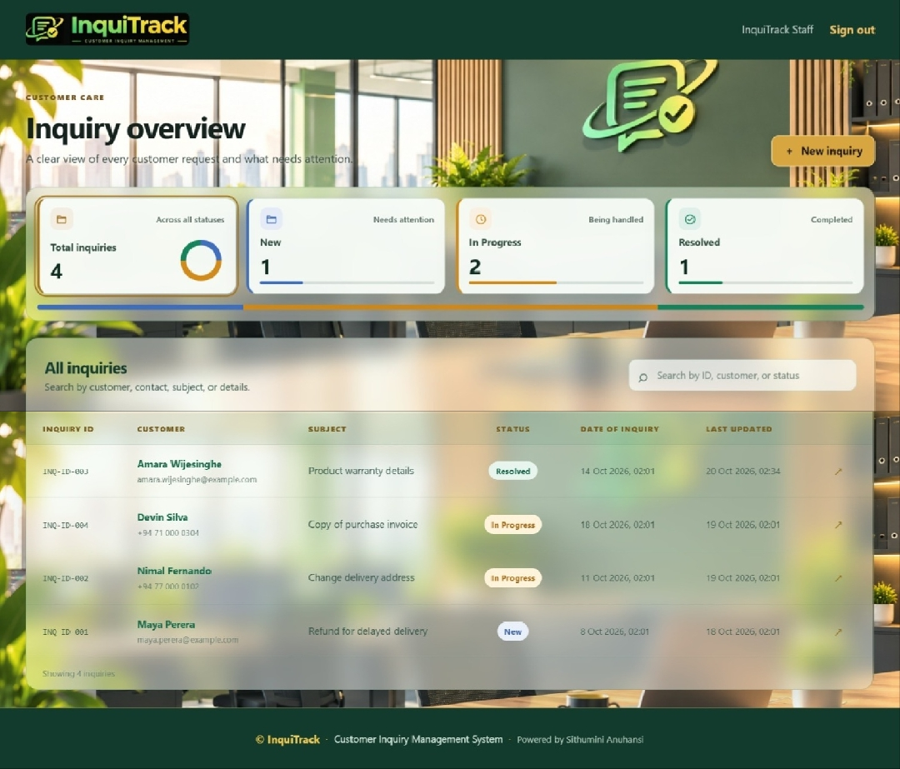](docs/screenshots/overview.jpeg)

### Inquiry details and status history

[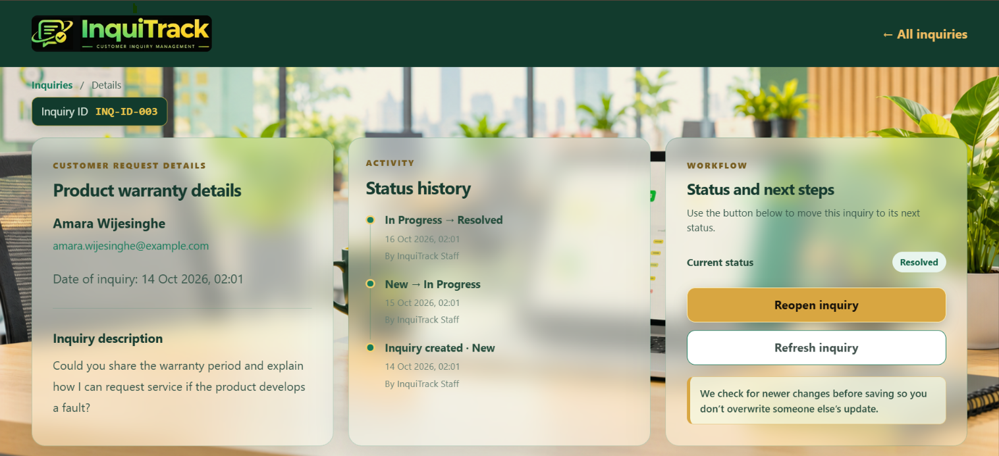](docs/screenshots/inquiry-details.png)

### New inquiry form

[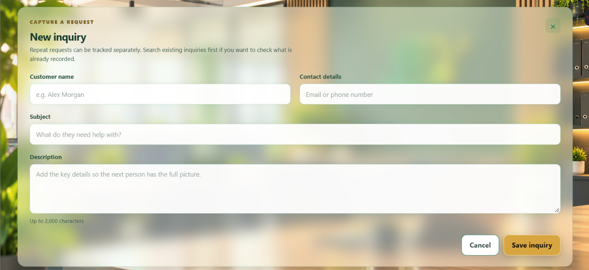](docs/screenshots/create-inquiry.png)

### Sign-in page and branding

[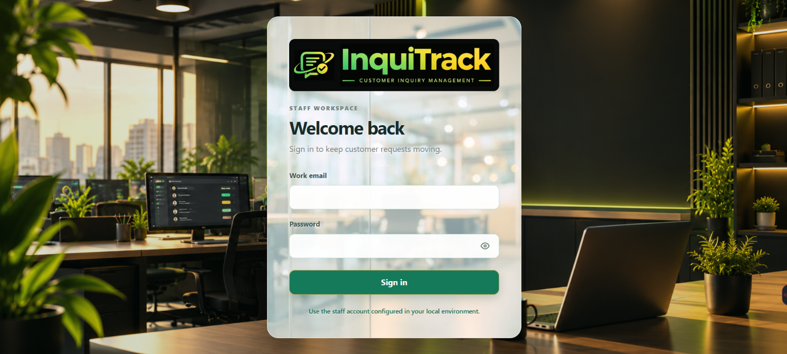](docs/screenshots/sign-in.png)

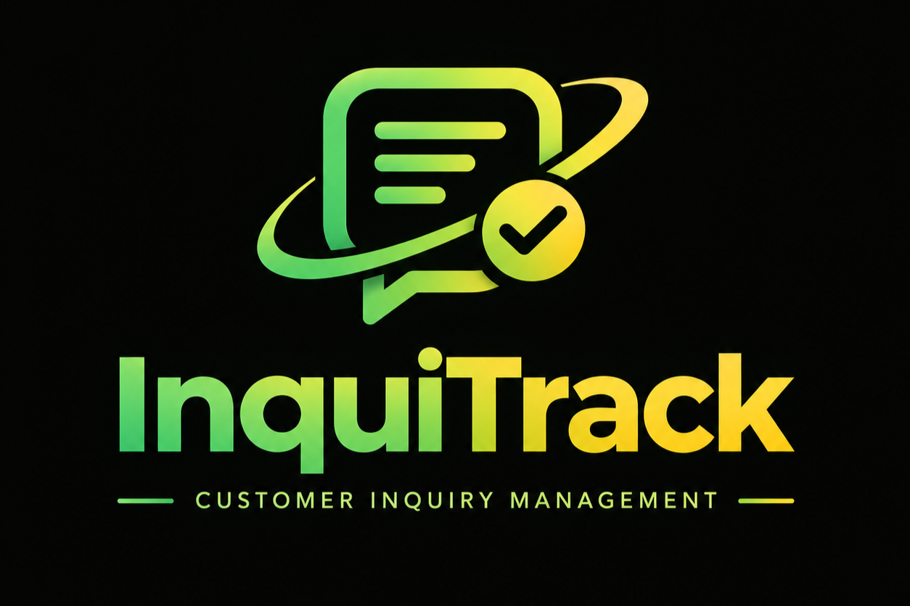

### Application workflow

[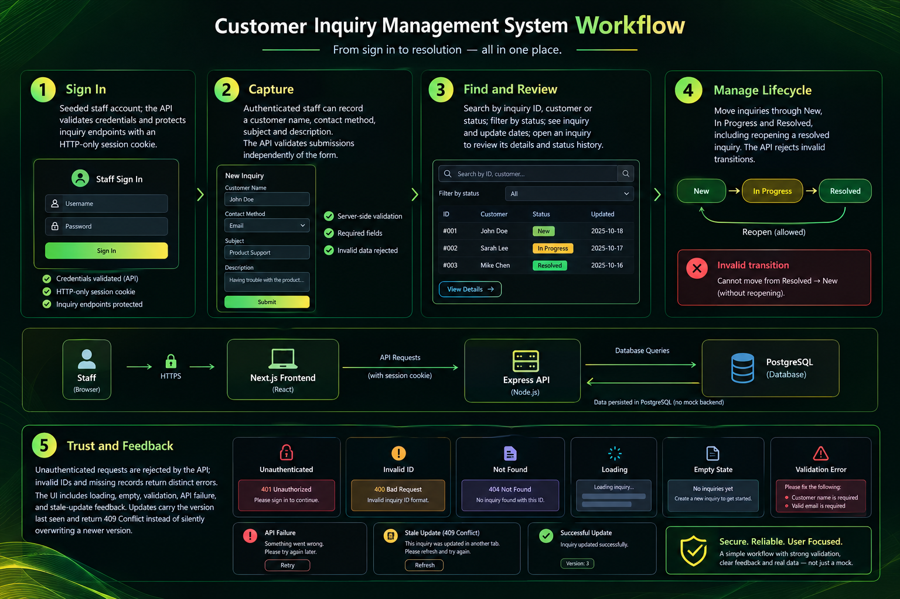](docs/screenshots/workflow.png)

## Demo video

Save or link a 3–5 minute end-to-end walkthrough here when it is recorded. It should show staff sign-in, the overview, creating and finding an inquiry, opening its details, changing status, and one validation or stale-update failure case. Briefly explain API-side authentication/validation and the client–server design choice. Do not show the `.env` file or its contents.

Suggested local file: `docs/demo/inquitrack-demo.mp4`. If the video is hosted elsewhere, add its shareable URL here. No demo video is included yet.

## Test screenshots

Test and setup evidence is stored in `docs/test-evidence/`. The API request capture below shows a connection failure because the API was not running; it is not evidence of a `401 Unauthorized` response. Start the application before capturing an unauthenticated API response.

### Automated test suites

[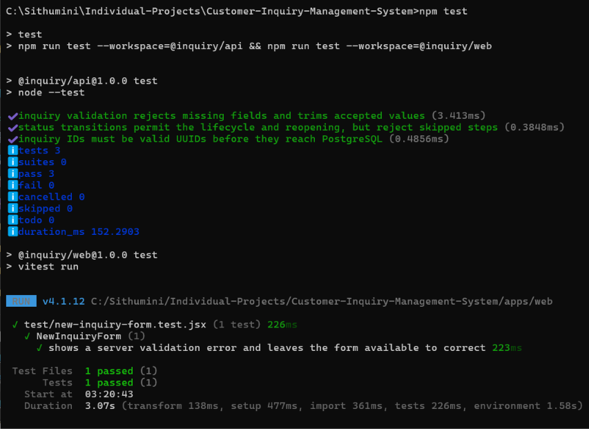](docs/test-evidence/automated-tests.png)

### Database setup

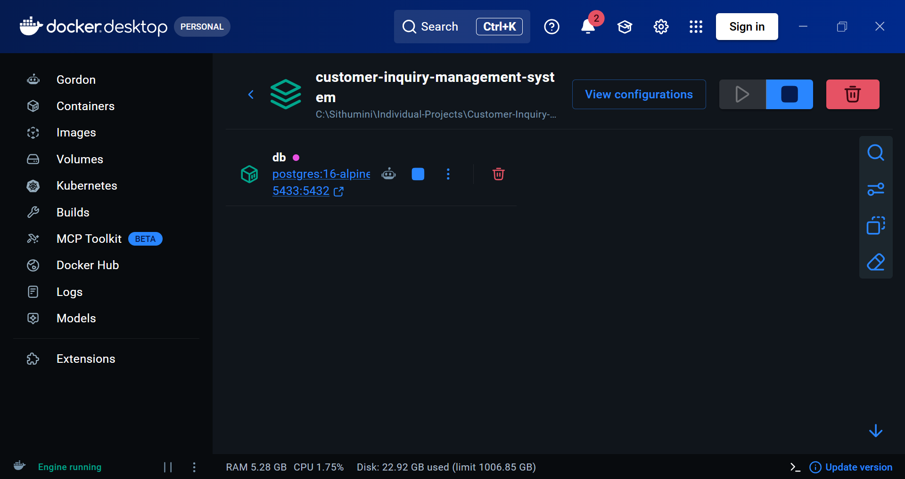

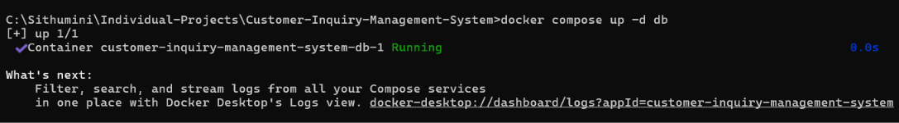

### Application feedback captures

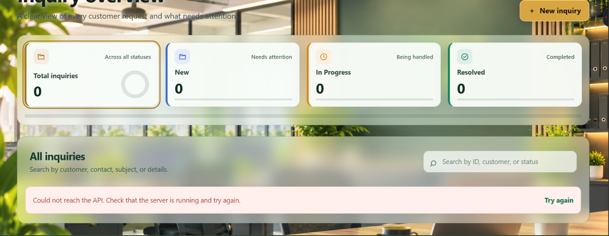

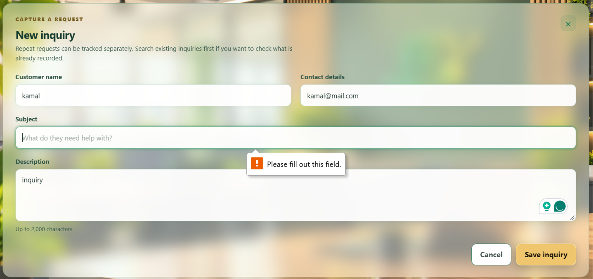

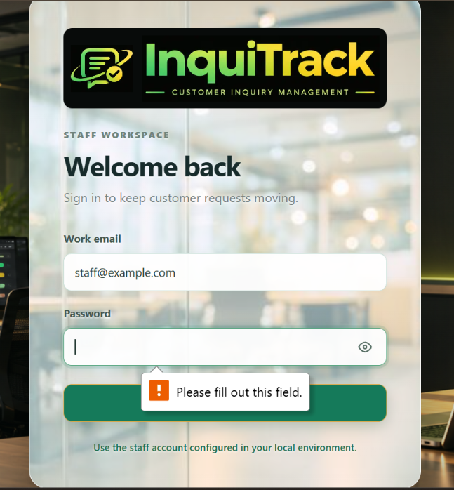

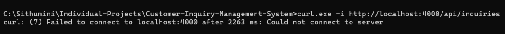

Screenshots supplement the test suites; they do not replace running the test commands above. Capture the API authentication response, server validation feedback, and stale-update conflict after starting the API and database if additional evidence is needed.

## API overview

- Authentication: `POST /api/auth/login`, `POST /api/auth/logout`, `GET /api/auth/me`
- Inquiries: protected routes under `/api/inquiries` for list/search, create, detail, and update
- Health: `GET /health`

All inquiry routes require the HTTP-only session cookie. Database migrations are in `apps/api/db/migrations`.
